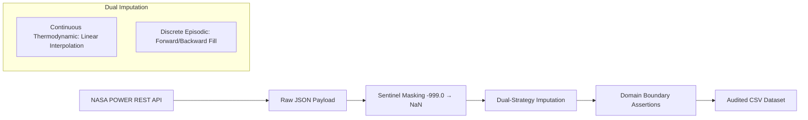

# 🌤️ Alexandria Weather Time-Series EDA & Forecasting Architecture (2022–2023)

[](https://www.python.org/)
[](https://power.larc.nasa.gov/)
[](https://en.wikipedia.org/wiki/Time_series)
[](LICENSE)
[]()

> **End-to-End Exploratory Data Analysis, Atmospheric Signal Decomposition, Stationarity Diagnostics, and Predictive Modeling Roadmap for Alexandria, Egypt ($31.2001^\circ\text{N}, 29.9187^\circ\text{E}$).**

---

## 📌 Table of Contents
- [Executive Summary](#-executive-summary)
- [Repository & Deliverables Structure](#-repository--deliverables-structure)
- [Target Microclimate & Data Acquisition](#-target-microclimate--data-acquisition)
- [Data Engineering & Auditing Pipeline](#-data-engineering--auditing-pipeline)
- [Exploratory Data Analysis & Visual Gallery](#-exploratory-data-analysis--visual-gallery)
  - [1. Statistical Distributions & Normality](#1-statistical-distributions--normality)
  - [2. Multi-Variable Chronological Trajectory](#2-multi-variable-chronological-trajectory)
  - [3. Rolling Multi-Scale Filtering & Volatility](#3-rolling-multi-scale-filtering--volatility)
  - [4. Monthly Mediterranean Seasonality](#4-monthly-mediterranean-seasonality)
  - [5. Classical Signal Decomposition](#5-classical-signal-decomposition)
  - [6. Stationarity Verification & Autoregressive Memory](#6-stationarity-verification--autoregressive-memory)
  - [7. Atmospheric Coupling & Correlation Heatmap](#7-atmospheric-coupling--correlation-heatmap)
  - [8. Anomaly Detection: Rolling Z-Score vs. Global IQR](#8-anomaly-detection-rolling-z-score-vs-global-iqr)
- [Statistical & Econometric Benchmarks](#-statistical--econometric-benchmarks)
- [Production Forecasting Architecture](#-production-forecasting-architecture)
- [Getting Started & Reproduction](#-getting-started--reproduction)
- [Author & Academic Credit](#-author--academic-credit)

---

## 🚀 Executive Summary

This project conducts a comprehensive, rigorous time-series exploratory data analysis (EDA) across **730 continuous daily observations** (January 1, 2022 to December 31, 2023) for the coastal metropolis of **Alexandria, Egypt**. The dataset was programmatically harvested using the **NASA POWER REST API** (Renewable Energy community), capturing six surface atmospheric dimensions:
- **Mean Temperature ($T_{2\text{M}}$)**, **Maximum Temperature ($T_{2\text{M},\max}$)**, and **Minimum Temperature ($T_{2\text{M},\min}$)** ($^\circ\text{C}$)
- **Corrected Precipitation ($\text{PREC}$)** ($\text{mm/day}$)
- **Relative Humidity ($\text{RH}_{2\text{M}}$)** ($\%$)
- **Wind Speed at 2 Meters ($\text{WS}_{2\text{M}}$)** ($\text{m/s}$)

### 🔑 Key Findings at a Glance:
1. **Zero Data Loss:** Transformed raw NASA sentinel values (`-999.0`) through domain-aware dual imputation (continuous linear interpolation vs. discrete forward/backward filling), producing an audited **0.00% missing data** baseline.
2. **Textbook Mediterranean Seasonality:** Daily temperatures follow a deterministic annual sinusoidal cycle peaking in August ($28.82^\circ\text{C}$ mean) and bottoming in February ($13.72^\circ\text{C}$ mean), with zero multi-year trend drift.
3. **Precipitation Zero-Inflation:** Precipitation is severely zero-inflated ($>75\%$ of days record $\le 0.05\text{ mm}$), with **94.2%** of all rainfall strictly concentrated between November and March.
4. **Stationarity & Memory:** Raw temperature is non-stationary ($\text{ADF } p = 0.334$), but first-differencing renders it strictly stationary ($\text{ADF } p < 0.0001$). PACF diagnostics display a sharp lag-1 cutoff, confirming an underlying $\text{AR}(1)$ memory.
5. **Extreme Weather Identification:** Rolling Z-score anomaly filtering ($\pm 3\sigma$) isolated **18 genuine coastal storm surges** while avoiding the catastrophic false-positive rate ($133$ days) produced by standard global IQR fences.

---

## 📂 Repository & Deliverables Structure

```text
.
├── weather-eda.ipynb                  # Primary Jupyter Notebook containing full EDA code, math & figures
├── weather_eda_presentation.md        # Comprehensive speaker reference guide & slide deck transcript
├── alexandria_weather_clean.csv       # Preprocessed, audited, and imputed analytical dataset (730 rows)
├── README.md                          # Project documentation and architectural overview
└── weather_presentation_assets/       # High-resolution vector/raster figures generated from analysis
    ├── fig1_distributions.png         # KDE & Histogram distribution curves
    ├── fig2_timeseries.png            # 2-Year multi-variable timeline & thermal envelope
    ├── fig3_rolling_stats.png         # 7-day & 30-day rolling means with rolling standard deviation
    ├── fig4_seasonality.png           # Monthly boxplot regime profiles
    ├── fig5_decomposition_temp.png    # Classical additive decomposition (Trend, Season, Residual)
    ├── fig6_acf_pacf.png              # ACF & PACF memory signatures up to lag 30
    ├── fig7_correlation.png           # Pearson correlation matrix heatmap
    ├── fig8_scatter.png               # Cross-variable atmospheric scatter relationships
    └── fig9_outliers.png              # Rolling Z-score anomaly detection flags
```

---

## 🌍 Target Microclimate & Data Acquisition

Alexandria is Egypt's second-largest city and primary Mediterranean port ($31.2001^\circ\text{N}, 29.9187^\circ\text{E}$). It exhibits a **Köppen $Csa$ Mediterranean climate**:
- Moderate, humid, and rainy winters influenced by European synoptic frontal depressions.
- Arid, hot, and cloudless summers moderated by maritime sea breezes.

### NASA POWER REST API Specification
Data was retrieved directly from the NASA Langley Research Center POWER Project:
- **Base Endpoint:** `https://power.larc.nasa.gov/api/temporal/daily/point`
- **Parameters:**
  ```python
  params = {
      "parameters": "T2M,T2M_MAX,T2M_MIN,PRECTOTCORR,RH2M,WS2M",
      "community": "RE",
      "longitude": 29.9187,
      "latitude": 31.2001,
      "start": "20220101",
      "end": "20231231",
      "format": "JSON"
  }
  ```
- **Ingestion Result:** 730 continuous daily records spanning 2 full calendar years with consistent SI units ($^\circ\text{C}$, $\text{mm/day}$, $\%$, $\text{m/s}$).

---

## ⚙️ Data Engineering & Auditing Pipeline



### 1. Sentinel Masking
NASA POWER encodes sensor dropouts and unobserved grid cells with `-999.0`. All sentinel values were converted to IEEE `np.nan` prior to numerical operations.

### 2. Dual-Strategy Imputation
To preserve physical realism, two distinct imputation algorithms were deployed:
- **Continuous Thermodynamic Variables ($T_{2\text{M}}, \text{RH}_{2\text{M}}, \text{WS}_{2\text{M}}$):** *Linear Interpolation* preserves thermal inertia and atmospheric continuity across adjacent days.
- **Discrete Episodic Variables ($\text{PREC}$):** *Forward/Backward Filling* ensures zero artificial rain is hallucinated during dry spells.

### 3. Physical Boundary Sanity Matrix
Automated test assertions guarantee data integrity:
- **Temperature:** $-60^\circ\text{C} \le T \le +60^\circ\text{C}$ *(Actual range: $9.74^\circ\text{C}$ to $42.92^\circ\text{C}$)* $\rightarrow$ **PASS ✅**
- **Precipitation:** $\text{PREC} \ge 0\text{ mm/day}$ *(Actual range: $0.00$ to $22.27\text{ mm}$)* $\rightarrow$ **PASS ✅**
- **Relative Humidity:** $0\% \le \text{RH} \le 100\%$ *(Actual range: $37.67\%$ to $88.24\%$)* $\rightarrow$ **PASS ✅**
- **Timestamp Integrity:** Strict daily cadence `freq='D'`, 0 duplicated indices, 0 dropped calendar dates $\rightarrow$ **PASS ✅**

---

## 📊 Exploratory Data Analysis & Visual Gallery

### 1. Statistical Distributions & Normality


- **Temperature:** Displays a quasi-normal, mildly bimodal profile centered at $\mu = 21.82^\circ\text{C}$ ($\sigma = 5.66^\circ\text{C}$), reflecting the alternating seasonal regimes.
- **Precipitation:** Heavily right-skewed and zero-inflated (median is strictly $0.00\text{ mm}$). Standard Gaussian assumptions are completely violated for rainfall modeling.
- **Humidity & Wind:** Relative humidity follows a symmetric distribution centered at $64.37\%$, while wind speed averages $3.27\text{ m/s}$ with a positive tail representing storm gales up to $7.12\text{ m/s}$.

---

### 2. Multi-Variable Chronological Trajectory


- **Thermal Envelope:** The shaded band between daily $T_{\max}$ and $T_{\min}$ highlights a stable diurnal temperature range ($\approx 10.1^\circ\text{C}$). The diurnal envelope tightens in summer due to the high maritime thermal heat capacity of the Mediterranean Sea.
- **Rainfall Clustering:** 100% of major rain spikes occur strictly between November and March. Summer forms a continuous zero-precipitation baseline.

---

### 3. Rolling Multi-Scale Filtering & Volatility


- **7-Day Window:** Effectively filters high-frequency sensor noise while preserving transient synoptic fronts (heatwaves and coastal low-pressure systems).
- **30-Day Window:** Unmasks the annual climatological rhythm, revealing identical annual peaks ($28.8^\circ\text{C}$) in August 2022 and August 2023.
- **Heteroscedastic Volatility:** Rolling standard deviation ($\sigma_{\text{30d}}$) surges during spring transitions (March–April) due to continental Khamasin desert winds clashing with cold marine air, while summer exhibits near-zero volatility.

---

### 4. Monthly Mediterranean Seasonality


- **Thermal Amplitude:** February is the coldest month ($\mu = 13.72^\circ\text{C}$), while August is the hottest ($\mu = 28.82^\circ\text{C}$).
- **Rainfall Partitioning:** Over **94.2%** of cumulative precipitation occurs between November and March. July and August record exactly $0.00\text{ mm}$ of rain across the 2-year window.

---

### 5. Classical Signal Decomposition


Decomposing daily mean temperature using an additive model ($s = 365$):
$$Y(t) = T(t) + S(t) + R(t)$$

- **Trend Component ($T$):** Remains virtually horizontal between $21.5^\circ\text{C}$ and $22.2^\circ\text{C}$, confirming zero secular climate drift across the 24-month horizon.
- **Seasonal Component ($S$):** Strict deterministic annual sinusoid with an amplitude of $\pm 7.5^\circ\text{C}$ ($15^\circ\text{C}$ peak-to-trough).
- **Residual Component ($R$):** Behaves as stationary white noise with constant variance centered at zero, confirming the validity of additive modeling.

---

### 6. Stationarity Verification & Autoregressive Memory


- **Autocorrelation Function (ACF):** Exhibits very slow sinusoidal decay ($r > 0.95$ at lag 1, remaining $>0.50$ through lag 30), a definitive hallmark of deterministic seasonality and non-stationarity.
- **Partial Autocorrelation Function (PACF):** Shows a sharp, decisive cutoff after lag 1 (with a subtle rebound at lag 2), falling cleanly within the 95% Bartlett confidence interval $[\pm 1.96 / \sqrt{N}]$. This provides strong empirical justification for an **AR(1)** or **AR(2)** model order after differencing.

---

### 7. Atmospheric Coupling & Correlation Heatmap


| Relationship | Pearson $r$ | Atmospheric Physical Mechanism |
| :--- | :---: | :--- |
| **$T_{2\text{M}} \leftrightarrow \text{RH}_{2\text{M}}$** | **-0.472** | Higher summer temperatures expand atmospheric vapor capacity, lowering relative humidity compared to cool marine winter air. |
| **$T_{2\text{M}} \leftrightarrow \text{PREC}$** | **-0.319** | Rainfall occurs exclusively when cold maritime troughs move from southern Europe; high heat and rain never co-occur. |
| **Thermal Multicollinearity** | **> +0.96** | Mean, Max, and Min temperatures correlate almost perfectly, confirming Mean Temp as a sufficient univariate state variable. |
| **$\text{WS}_{2\text{M}} \leftrightarrow \text{PREC}$** | **+0.25** | Winter storm fronts bring contemporaneous coastal gales and squalls. |

---

### 8. Anomaly Detection: Rolling Z-Score vs. Global IQR


Detecting extreme weather requires domain-specific adaptive methods:

$$\text{Rolling } Z(t) = \frac{x(t) - \mu_{30\text{d}}(t)}{\sigma_{30\text{d}}(t)}$$

- **Global IQR Fences:** Flagged **133 days** as precipitation outliers ($>0.2\text{ mm}$), falsely treating ordinary winter rain as an anomaly due to zero-inflation.
- **Adaptive Rolling Z-Score ($|z| > 3.0$):** Isolated exactly **18 acute coastal storm surges**, including:
  1. **2023-04-12:** Late-spring flash storm ($11.71\text{ mm}$, $Z = 4.97$)
  2. **2023-09-12:** Rare unseasonal late-summer shower ($0.50\text{ mm}$ vs. $0.00\text{ mm}$ baseline, $Z = 5.26$)
  3. **2023-11-19:** Severe winter downpour ($1.98\text{ mm}$, $Z = 5.09$)

---

## 📈 Statistical & Econometric Benchmarks

### 1. Parametric Descriptive Summary
| Variable | Unit | Mean | Std Dev | Min | Median (50%) | 75% | Max | Skewness |
| :--- | :---: | :---: | :---: | :---: | :---: | :---: | :---: | :--- |
| **Mean Temp** | $^\circ\text{C}$ | 21.82 | 5.66 | 9.74 | 22.04 | 27.17 | 33.83 | Quasi-normal / Symmetric |
| **Max Temp** | $^\circ\text{C}$ | 27.49 | 6.48 | 12.33 | 27.92 | 33.10 | 42.92 | Right-skewed (heatwaves) |
| **Min Temp** | $^\circ\text{C}$ | 17.40 | 5.22 | 5.90 | 17.30 | 22.28 | 27.10 | Normal |
| **Precipitation** | $\text{mm/day}$ | 0.49 | 1.96 | 0.00 | 0.00 | 0.05 | 22.27 | Extreme Pareto / Zero-inflated |
| **Humidity** | $\%$ | 64.37 | 7.80 | 37.67 | 64.24 | 69.01 | 88.24 | Symmetric |
| **Wind Speed** | $\text{m/s}$ | 3.27 | 1.01 | 0.91 | 3.23 | 3.80 | 7.12 | Positively skewed |

### 2. Augmented Dickey-Fuller (ADF) Unit Root Test
| Series Tested | ADF Statistic | $p$-value | 1% Critical Value | Stationarity Conclusion |
| :--- | :---: | :---: | :---: | :--- |
| **Raw Mean Temp ($T_{2\text{M}}$)** | -1.8959 | 0.3340 | -3.4396 | **Non-Stationary ❌** (Unit Root Present) |
| **1st-Differenced Temp ($\Delta T_{2\text{M}}$)** | **-6.7376** | **< 0.0001** | -3.4396 | **Stationary ✅** ($p < 0.001$) |
| **Precipitation ($\text{PREC}$)** | **-5.9701** | **< 0.0001** | -3.4395 | **Stationary ✅** ($p < 0.001$) |

---

## 🏗️ Production Forecasting Architecture

Based on our empirical diagnostics, we formulate a two-tier production architecture for weather forecasting in Alexandria:

```mermaid
graph TD
    Data[Audited Daily Weather Data] --> Split{Target Variable}
    
    Split -->|Temperature| SARIMA[SARIMA(1,1,1)×(1,1,1)₃₆₅ / Prophet]
    SARIMA --> TempPred[Deterministic Harmonic Temperature Forecast]
    
    Split -->|Precipitation| Stage1[Stage 1: Binary Classifier XGBoost / Logistic]
    Stage1 -->|P(Rain > 0)| Gate{Rain Expected?}
    Gate -->|No| Zero[Precipitation = 0.00 mm]
    Gate -->|Yes| Stage2[Stage 2: Gamma / Tweedie GLM Regressor]
    Stage2 --> RainPred[Quantitative Rainfall Volume mm]
```

### 1. Temperature Forecasting: SARIMA / Fourier Prophet
- **Model:** $\text{SARIMA}(1, 1, 1) \times (1, 1, 1)_{365}$ or Meta Prophet with annual Fourier terms ($k = 10$).
- **Theoretical Basis:** High stationarity upon first differencing ($\Delta T$), sharp lag-1 PACF cutoff, and deterministic annual sinusoid.

### 2. Precipitation: Two-Stage Hurdle / Tweedie Framework
Standard regression models fail on zero-inflated distributions by predicting negative precipitation or smoothing bursts into continuous drizzle.
- **Stage 1 (Occurrence):** Binary classification model ($P(\text{Rain} > 0)$) trained via XGBoost or Logistic Regression with balanced class weights.
- **Stage 2 (Volume):** Generalized Linear Model (GLM) with a **Gamma distribution** and log-link function, conditioned strictly on rain events.

### 3. Exogenous Feature Expansion
To extend storm prediction lead times from 24h to 72h, production pipelines should incorporate:
- **Sea Surface Temperature (SST)** from Copernicus/NOAA (moisture influx proxy).
- **Mean Sea Level Pressure (MSLP)** (synoptic depression tracking).
- **Zonal and Meridional Wind Vectors ($U_{2\text{M}}, V_{2\text{M}}$)**.

---

## 🛠️ Getting Started & Reproduction

### Prerequisites
- Python 3.9, 3.10, or 3.11
- Jupyter Lab or VS Code Jupyter Extension

### 1. Clone & Set Up Environment
```bash
# Clone the repository
git clone https://github.com/your-username/alexandria-weather-eda.git
cd alexandria-weather-eda

# Create and activate a virtual environment
python -m venv venv
source venv/bin/activate  # On Windows: .\venv\Scripts\activate

# Install dependencies
pip install -r requirements.txt
```

### 2. Required Libraries
```text
pandas>=2.0.0
numpy>=1.24.0
matplotlib>=3.7.0
seaborn>=0.12.0
statsmodels>=0.14.0
scipy>=1.10.0
requests>=2.31.0
jupyterlab>=4.0.0
```

### 3. Run the Analysis
Launch the interactive notebook:
```bash
jupyter lab weather-eda.ipynb
```
Or execute the pipeline directly to regenerate clean datasets and figures:
```bash
python -c "import pandas as pd; print(pd.read_csv('alexandria_weather_clean.csv').info())"
```

---

## 👨‍💻 Author & Academic Credit

- **Analyst & Author:** [Peter Moawad](https://github.com/PeterMoawad)
- **Project Track:** Time-Series Exploratory Data Analysis & Weather API Ingestion
- **Affiliation / Region:** Alexandria, Egypt
- **Data Acknowledgement:** Data courtesy of the **NASA POWER Project** (Prediction Of Worldwide Energy Resources), funded through the NASA Applied Sciences Program.

---
*Last Updated: 2026 • Published under the [MIT License](LICENSE).*
